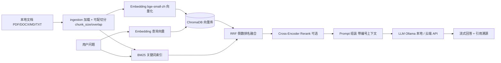

# 本地 RAG 知识库（Local-RAG）

一个可在个人 Windows 电脑上离线运行的检索增强生成（RAG）问答系统：把本地文档
（PDF / Word / Markdown / TXT）切分、向量化后存入本地向量库，提问时先混合检索
相关片段，再由大模型生成的回答。

> Embedding 走 CPU，本地 LLM 用ollama
> 小参数模型（默认 DeepSeek-R1-Distill-Qwen-1.5B），显存紧张时可一键切换云端 API。

---

## 目录

- [本地 RAG 知识库（Local-RAG）](#本地-rag-知识库local-rag)
  - [目录](#目录)
  - [1. 项目简介与适用场景](#1-项目简介与适用场景)
  - [2. 架构说明](#2-架构说明)
  - [3. Windows 从零安装与运行](#3-windows-从零安装与运行)
    - [第 0 步：安装前置软件](#第-0-步安装前置软件)
    - [第 1 步：创建虚拟环境并装依赖](#第-1-步创建虚拟环境并装依赖)
    - [第 2 步：配置环境变量](#第-2-步配置环境变量)
    - [第 3 步：拉取本地大模型（1.5B 量化版约 1GB 内，按需等待）](#第-3-步拉取本地大模型15b-量化版约-1gb-内按需等待)
    - [第 4 步：把文档入库](#第-4-步把文档入库)
    - [第 5 步：启动后端 + 前端（开两个终端）](#第-5-步启动后端--前端开两个终端)
  - [4. 分阶段开发路线](#4-分阶段开发路线)
  - [5. 配置说明](#5-配置说明)
  - [6. 量化评估（Recall@k / MRR）](#6-量化评估recallk--mrr)
  - [7. 显存不足的降级方案](#7-显存不足的降级方案)
  - [8. 项目结构](#9-项目结构)
  - [License](#license)

---

## 1. 项目简介与适用场景

**做什么**：把一堆本地资料变成一个可以对话提问的知识库，回答时标注来源文件与段落，
可用于个人笔记问答、公司制度/产品手册内部检索、学习资料复习等。

**技术栈**：Python 3.12 · ChromaDB · sentence-transformers（bge-small-zh）·
rank-bm25 · RRF 混合检索 · Cross-Encoder 重排 · Ollama（本地 LLM）·
FastAPI（流式 SSE）· Streamlit（界面）。

**不依赖 LangChain**：检索链路（加载→切分→向量/BM25 召回→RRF 融合→重排→生成）
全部手写，便于理解原理；后续可在其上叠加 LangChain。

---

## 2. 架构说明



ASCII 版数据流：

```
文档 ──► 加载器 ──► 切分(chunk) ──► Embedding ──► ChromaDB(稠密)
                                          └──────► BM25(稀疏)
问题 ──► Embedding ──► 稠密召回 ─┐
              └──────► BM25 召回 ─┴─► RRF 融合 ─► Rerank ─► Prompt ─► LLM ─► 回答+引用
```

**模块职责**：

| 模块          | 职责                                                         |
| ------------- | ------------------------------------------------------------ |
| `config/`     | 配置与代码分离：`.env` 放密钥/开关，`config.yaml` 放可调参数 |
| `ingestion/`  | 多格式文档加载（pypdf / python-docx / 纯文本）+ 段落感知切分 |
| `retrieval/`  | 稠密向量检索 + BM25 稀疏检索 + RRF 融合 + Cross-Encoder 重排 |
| `generation/` | Prompt 组装、Ollama/云端双路 LLM 调用、流式生成、引用溯源    |
| `api/`        | FastAPI：`/ingest` 入库、`/chat` SSE 流式问答、会话历史      |
| `frontend/`   | Streamlit：上传文档、流式问答、展开查看来源                  |
| `eval/`       | 自建 JSONL 测试集 + Recall@k / MRR 基线对比                  |

---

## 3. Windows 从零安装与运行

> 全程在项目根目录 `local-rag/` 下操作。

### 第 0 步：安装前置软件

1. 安装 **Python 3.12**（官网 python.org，安装时勾选 *Add Python to PATH*）。
2. 安装 **Ollama Windows 桌面版**：<https://ollama.com/download>，装完后托盘出现图标即后台运行。

### 第 1 步：创建虚拟环境并装依赖

```powershell
# 在项目根目录执行
python -m venv .venv
.venv\Scripts\activate          # PowerShell 激活；CMD 用 .venv\Scripts\activate.bat
pip install -r requirements.txt
```

### 第 2 步：配置环境变量

```powershell
copy .env.example .env
```

打开 `.env`，默认 `LLM_PROVIDER=local` 即可；显存不够再改 `cloud`（见第 7 节）。

### 第 3 步：拉取本地大模型（1.5B 量化版约 1GB 内，按需等待）

```powershell
ollama pull DeepSeek-R1-Distill-Qwen-1.5B
```

> 对应模型 DeepSeek-R1-Distill-Qwen-1.5B，体积小、4GB 显存可轻松跑。想换模型，改 `.env` 的 `LOCAL_MODEL` 并 `ollama pull` 对应标签即可。

### 第 4 步：把文档入库

把自己的资料放进 `data/` 目录（自带 `data/sample/` 示例可直接先用），然后：

```powershell
python app.py ingest
```

> Embedding 模型 `BAAI/bge-small-zh-v1.5` 首次运行自动下载（约 100MB 级，CPU 运行）。

### 第 5 步：启动后端 + 前端（开两个终端）

终端 A（后端，默认 8000 端口）：

```powershell
python app.py api
```

终端 B（前端，默认 8501 端口）：

```powershell
python app.py web
```

浏览器自动打开 Streamlit 页面即可提问；也可以直接访问后端文档
<http://127.0.0.1:8000/docs> 试用 `/ingest`、`/chat`。

**最小验证命令**（只想先跑通一次）：

```powershell
python app.py ingest
python app.py api      # 另开终端
```

---

## 4. 分阶段开发路线

| 阶段              | 目标                                             | 对应内容                                     |
| ----------------- | ------------------------------------------------ | -------------------------------------------- |
| **MVP（先跑通）** | 文档入库 + 单轮问答 + 展示答案                   | `ingest` → `api` → `web`，先不开 rerank 也行 |
| **检索优化**      | 混合检索 + RRF + rerank，调 chunk_size/overlap   | `retrieval/`、`config.yaml` 调参             |
| **量化评估**      | 建 20~50 条测试集，跑 Recall@5 / MRR 对比        | `eval/`                                      |
| **工程化**        | 流式输出、对话记忆、配置分离、异常处理、引用溯源 | `api/`、`generation/`、`config/`             |

调参建议（写进 eval 报告前先试）：
- `chunk_size`：文档以段落为主取 400~600 字符；小块多检索更细但易碎。
- `chunk_overlap`：取 `chunk_size` 的 10%~20%，防止跨块语义断裂。
- `final_top_k`：送进 Prompt 的块数，3~5 为宜，太多会稀释重点、占上下文。

---

## 5. 配置说明

`.env`（密钥 / 开关，不提交 git）：

| 变量                                               | 说明                                             |
| -------------------------------------------------- | ------------------------------------------------ |
| `LLM_PROVIDER`                                     | `local`（Ollama）/ `cloud`（OpenAI 兼容 API）    |
| `LOCAL_MODEL`                                      | 本地模型名，默认 `DeepSeek-R1-Distill-Qwen-1.5B` |
| `CLOUD_BASE_URL` / `CLOUD_API_KEY` / `CLOUD_MODEL` | 云端 API 三要素                                  |
| `EMBEDDING_MODEL`                                  | 默认 `BAAI/bge-small-zh-v1.5`                    |
| `DEVICE`                                           | `auto` / `cuda` / `cpu`                          |

`config/config.yaml`（可调检索参数）：`chunking.chunk_size/chunk_overlap/chunk_unit`、
`retrieval.dense_top_k/sparse_top_k/final_top_k/rrf_k`、`rerank.enabled/model/threshold`。

---

## 6. 量化评估（Recall@k / MRR）

1. 参考 `eval/dataset.example.jsonl` 扩充到 20~50 条，每行一条：

```json
{"question": "问题", "answer": "参考答案(仅人工对照)", "relevant_docs": ["文件名.md"]}
```

2. 先 `python app.py ingest` 建库，再运行对比：

```powershell
python app.py eval --k 5
```

脚本会分别跑「混合检索（无 rerank）」和「混合检索 + rerank」，输出 Recall@5 / MRR
对比表，并写入 `eval/report.md`。用报告里的真实数字写简历（见第 8 节）。

---

## 7. 显存不足的降级方案

按优先级逐级降级，改配置即可、无需改代码：

1. **关闭 rerank**：`config.yaml` 设 `rerank.enabled: false`（省下重排模型占用）。
2. **换更小的本地模型**：`.env` 把 `LOCAL_MODEL` 改为更小的 Ollama 标签，
   例如 `qwen2.5:0.5b`，并先 `ollama pull` 对应标签。
3. **强制 CPU 跑 Embedding/rerank**：`.env` 设 `DEVICE=cpu`。
4. **切云端 API**：`.env` 设 `LLM_PROVIDER=cloud`，填 `CLOUD_BASE_URL / CLOUD_API_KEY / CLOUD_MODEL`
   （任意 OpenAI 兼容服务），本地只保留检索。

---

## 8. 项目结构

```
local-rag/
├── config/              # 配置：settings.py + config.yaml（密钥走 .env）
├── ingestion/           # 文档加载(PDF/MD/TXT/DOCX) + 可配切分
├── retrieval/           # 向量检索 + BM25 + RRF 融合 + rerank + 编排
├── generation/          # Prompt 组装 / LLM 双路调用 / 引用溯源
├── api/                 # FastAPI：/ingest、/chat(SSE)、/health
├── frontend/           # Streamlit 问答界面（上传 + 提问 + 来源）
├── eval/                # 测试集模板 + Recall@k/MRR 基线对比
├── data/                # 放用户文档；sample/ 为示例；chroma/ 自动生成
├── app.py               # 统一 CLI：ingest / api / web / eval
├── requirements.txt
├── .env.example
└── README.md
```

## License

仅作个人学习项目使用。
